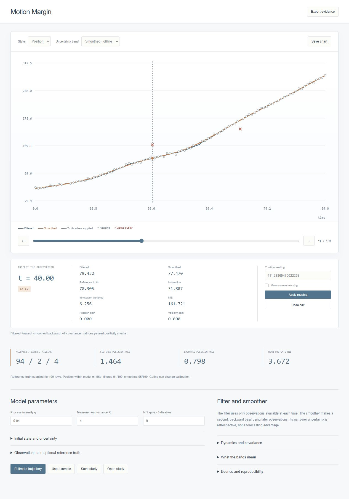
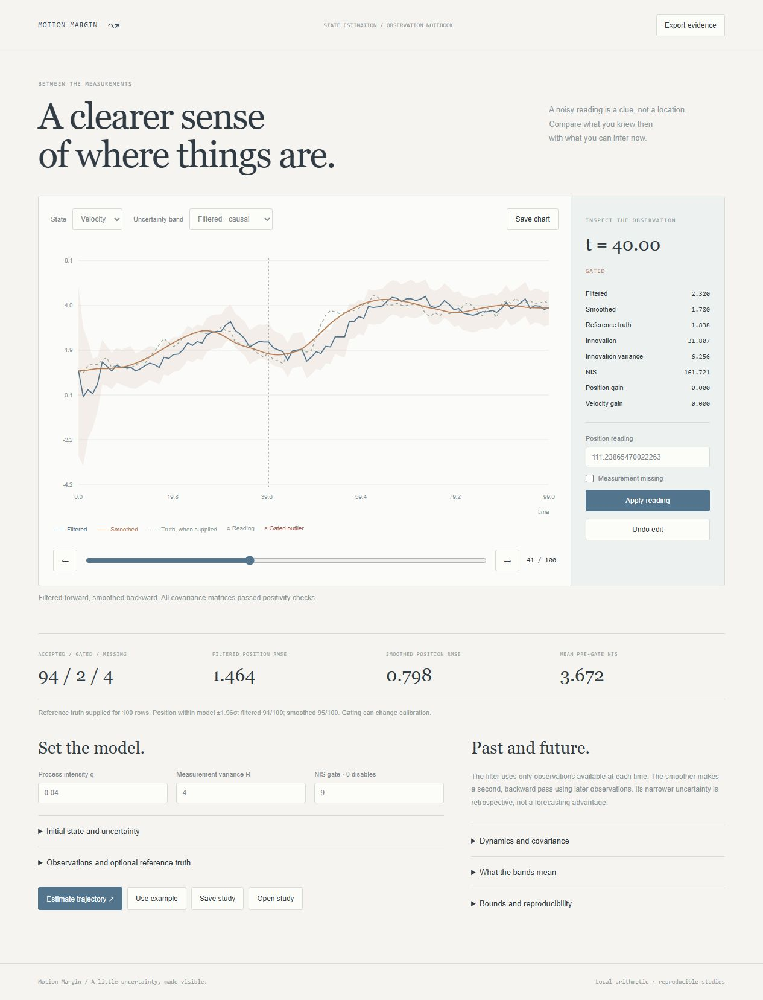

# Motion Margin

A local state-estimation notebook for noisy one-dimensional motion. Compare causal Kalman filtering with retrospective Rauch–Tung–Striebel smoothing, inspect innovations and gains, and edit missing or outlying measurements.



The full-width trajectory chart keeps observation details in a strip below the plot. Filtered and smoothed markers follow the inspection cursor without redrawing the trajectories; model changes reveal the new curves. Reduced-motion preferences disable these transitions.

## Run

Python 3.10+ serves the static app. Node 22+ runs checks. No packages, build step, accounts, or external services.

```sh
python run.py --port 8000
```

Open http://127.0.0.1:8000. The deterministic example has 100 observations, four missing readings, and two deliberately contaminated readings. With the default gate, 94 readings are accepted and two rejected. Filtered position RMSE is about 1.464; smoothed RMSE is about 0.798. Disabling the gate changes these to approximately 2.691 and 1.262. These are example results, not general performance guarantees.

## Model

State is `[position, velocity]`. For a time gap Δt:

```text
F = [[1, Δt], [0, 1]]
Q = q [[Δt³/3, Δt²/2], [Δt²/2, Δt]]
H = [1, 0]
```

The model uses continuous white acceleration with intensity q and independent position measurement variance R. The diagonal initial covariance and mean apply at the first observation time. Accepted observations use a Joseph-form covariance update. Missing observations propagate the prior without correction. A positive NIS gate rejects a reading when squared innovation divided by innovation variance exceeds the threshold; zero disables rejection.

The RTS backward pass uses the forward filter's accepted measurement set. It is an offline estimator using future data, not a causal forecasting improvement. Covariances are symmetrized and checked for finite, positive-definite values; the app reports a numerical error instead of silently adding covariance jitter.

## Workbench

- Position and velocity charts show filtered/smoothed means, optional supplied truth, and selectable marginal uncertainty bands.
- Keyboard arrows, Home/End, timeline scrubbing, and chart clicks inspect individual observations, innovations, normalized innovation squared, and both Kalman gains.
- Edit one reading, mark it missing, or modify the full observation JSON. Twenty study edits can be undone.
- Tune process intensity, measurement variance, gating, and prior mean/variance. Unapplied drafts disable result exports.
- Import/export portable studies, export complete numerical evidence, and save standalone SVG charts.
- Truth is optional. RMSE and empirical band coverage are unavailable without supplied reference states. Mean pre-gate NIS includes rejected observations and excludes missing ones.



## Interpretation and limits

Bands are marginal means ±1.96 model standard deviations. They rely on the linear Gaussian model. Data-dependent gating changes the selected observation set; the reported covariance does not condition on the selection event, so 95% coverage is not guaranteed after rejection. Supplied truth is used only for evaluation and drawing, never to fit the filter.

Studies accept 2–500 observations. Times are 0–1,000,000 with successive gaps of 0.1–10. Position measurements/prior position are bounded to ±100,000, prior velocity to ±10,000, q to 0.001–100, R/prior variances to 0.001–10,000, and NIS gate to 0–1,000. JSON files are limited to 200 KB. This is a bounded one-dimensional model, with no live sensors, nonlinear dynamics, automatic parameter fitting, or hardware control.

## Verification

```sh
npm test
npm run check
python -m unittest discover -s tests -v
```

Six Node tests independently assemble and invert full-trajectory Gaussian precision matrices for 40 irregular studies, comparing all smoothed states/covariances and every filtered prefix. Additional cases cover skipped measurements, gating equivalence to removing rejected readings, all-missing data, covariance positivity at extreme settings, and validation. A Python HTTP test checks asset isolation, HEAD, and Host validation. CI runs Node 22/24 on Ubuntu and Node 24 on Windows.

Browser checks covered gating changes, missing-data edits, undo, keyboard inspection, no-truth studies, invalid timestamps, study import, and evidence/SVG exports. A separate Python 200-dimensional Gaussian solve verified every smoothed state and covariance block in the downloaded 100-observation example; the maximum mean difference was about 7.5e-12. Exported RMSE values were independently recomputed.

Fixtures: [example study](docs/example.json), [exported chart](docs/example-chart.svg). Background: [Stanford EE363 lecture materials](https://ee363.stanford.edu/archive/lectures.html) and [Smoothing Problems in a Bayesian Framework and Their Linear Gaussian Solutions](https://doi.org/10.1175/MWR-D-10-05025.1).
